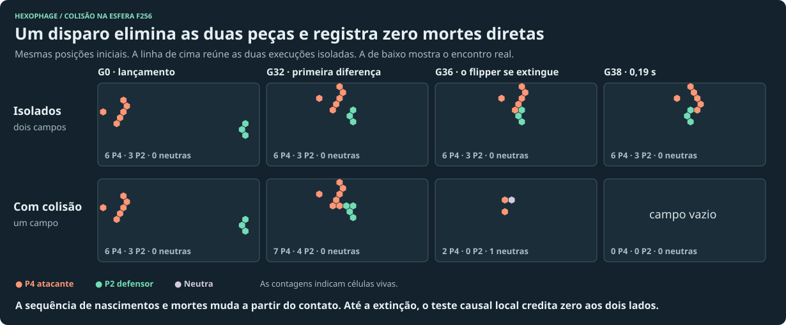

# Quem ganha energia numa colisão?

**A geometria do tiro já muda a economia.** No teste em que um glider P4 interrompe a ponta do crescedor inimigo, o atacante gastou 160 energias entre compra e operação. Nos mesmos 512 passos, o defensor perdeu 42.448 de rendimento diante do controle sem interferência. Se o disparo passa ao lado, o atacante gasta 2.620 e a fazenda segue crescendo. Com uma simples troca de alvo, o mesmo tipo de glider pode *criar* um crescedor para o adversário.

Os valores acima usam o cenário de pesquisa que cobra uma energia por nascimento e paga 129 uma vez à célula nascida naturalmente que chega à idade 64. O preço do carimbo foi o controle linear de dez por célula. O atacante e o defensor têm caixa para manter as linhagens em observação. As contas deste estudo não alteram a partida publicada.

## O retorno militar do disparo

| Ação do jogador | Gastou em 512 gerações, incluindo compra | Quanto o defensor perdeu de renda frente ao controle | Melhora da diferença econômica do atacante frente a guardar o dinheiro |
| --- | ---: | ---: | ---: |
| Acertar a ponta da colmeia | 160 | 42.448 | +42.288 |
| Mesmo tiro, lançamento 16 gerações depois | 95 | 41.531 | +41.436 |
| Glider fora da rota | 2.620 | 0 | −2.620 |
| Acertar o refletor P42 na fase que gera uma colmeia inimiga | 174 | −39.238 | −39.412 |
| Eliminar o flipper P2 que vinha dando despesa ao defensor | 232 | −955 | −1.187 |

Na inversão simples, que remunera a cada geração todas as células sobreviventes, o mesmo tiro na ponta reduziu em 96.597 o saldo operacional do defensor até a geração 512. A regra de renda altera o valor do alvo. Um prejuízo imposto ao rival também pode valer uma vitória sem acrescentar nada à reserva de quem disparou. [Pares de cenários e fórmulas](paired-economy.mjs) · [Resultados por alvo e por regime](paired-economy.json).

## Como reconhecer que houve combate

Uma célula recebe crédito como morte direta se, partindo do **mesmo estado imediatamente anterior**, ela sobrevive ao remover os vizinhos adversários e morre com eles presentes. Os vizinhos neutros continuam no tabuleiro. Na regra de Callahan, a morte desse tipo exige superlotação. Também distinguimos um nascimento impedido, uma célula que o adversário ajudou a sobreviver e um nascimento de pais rivais que resulta numa célula neutra. A sequência física inteira com e sem o tiro mede a consequência indireta.



Foram 1.548 lançamentos legais de P4, com cinco alvos, seis direções e diferentes corredores e fases na f48. Observamos 96 gerações por lançamento, além de replays específicos na f256. Dos 573 disparos que alteraram o campo do defensor em algum instante, **47** causaram uma morte direta dele, **456** impediram um de seus nascimentos num local anteriormente vazio e **300** permitiram que uma de suas células sobrevivesse em um passo em que teria morrido. As categorias se sobrepõem. Dos 132 defensores extintos até o fim da janela, 121 desapareceram sem morte diretamente atribuível ao atacante. Dos 808 projéteis extintos cujo controle isolado sobrevivia, 784 desapareceram sem morte diretamente atribuível ao defensor. [Ensaios e controles](contacts.md) · [Causalidade local e coletiva](causality.md).

## O que pagar e de onde tirar a energia

| Regra ensaiada | O que ocorreu |
| --- | --- |
| Emitir uma energia para quem matou diretamente | Duas peças que se repetem a cada seis gerações, sem mudar nenhuma posição nem dono ao fim do ciclo, geram 240 mil energias novas em duas horas a 200 gerações/s em regime periódico. Duas P20 de frente uma para outra também repetem um fluxo de baixas. |
| Transferir da reserva da vítima para quem matou | Na grade, só 32 tiros deram transferência líquida positiva ao atacante. O maior diferencial de baixas foi três; para recuperar os 60 da compra de um P4 seriam necessárias pelo menos 20 energias por morte, sem contar o voo. A esta tarifa um único tiro recuperou a compra. No tiro que cortou a colmeia em G0, quem recebe é o defensor. Pagar a indenização na direção inversa permite lançar uma peça descartável contra o rival para cobrar dele. |
| Transferir a taxa que o rival economizou quando seu nascimento foi impedido | Na inversão, uma fração de 100% permite transferir até a tarifa de uma energia que a outra facção pagaria se aquela célula tivesse nascido. Os dois tiros que suprimiram a colmeia deram +1 líquido ao atacante. Entre os 132 defensores extintos, o saldo sobrou para o defensor em 75 casos, para o atacante em 32 e empatou em 25. Uma fronteira periódica transferiu 57,14 energias/s à mesma parte em caixa financiado. |
| Liberar no ponto do choque parte do custo que a célula efetivamente pagou | Marcamos mortes ocorridas com vizinho rival, incluindo mortes que aconteceriam sem ele. Metade de um custo de entrada de 1 energia ficou recuperável no hexágono. A primeira célula de um jogador nascida naturalmente ali recolhe o depósito, inclusive se for do dono original. Nos 1.548 disparos, 469 energias ficaram no terreno, 272 foram recolhidas até G96 e 197 continuaram pendentes. Destas 272, **246 foram para defensores e 26 para atacantes**. O maior resgate por um atacante em um disparo foi de 1,5 energia. |

A sucata é uma defesa recuperável para quem conserva o local. Distinguir dono original e coletor dá outra leitura dos mesmos 272: 171 voltaram a quem tinha pago pelo material e 101 mudaram de facção. Restringir depósitos às mortes de causalidade direta deixou somente 40 no terreno e 26 recolhidas até G96. Cada depósito só pode sair uma vez. Nos testes ele pressupõe uma energia já paga ao nascer ou como parte do preço de plantio. Uma célula sem custo pago não financia sucata. No ensaio de duas P20 frente a frente, deslocar uma arma em duas colunas manteve as duas operando e mudou as mortes diretas de quatro para zero por período. No alinhamento de quatro mortes, o valor de sucata recolhido entre G200 e G220 voltou integralmente aos donos originais. [Duas linhas de tiro](crossfire.json). A soma das carteiras pode aumentar quando um depósito é resgatado; o total de carteiras **mais** valor reservado para recuperação não aumenta por esse resgate. [Recuperação no terreno](salvage-results.json) · [Imposto, indenização e emissão](payoffs.md).

As transferências entre carteiras limitam o débito ao caixa disponível antes da liquidação da geração. Na falta de saldo, os credores dividem o que existe proporcionalmente. Esse limite evita criar energia ou dívida só pela colisão. Ainda permite a uma facção manter outra sob tributo enquanto a vítima tiver renda. A emissão por baixa cria energia mesmo quando ambos repetem a mesma posição indefinidamente. O precedente de *Beyond All Reason* é útil para a outra ideia. Unidades deixam destroços e quem chega ao local com capacidade de coleta pode recuperar metal. Em Hexophage a própria expansão do autômato pode coletar, sem acrescentar um comando manual. [Manual de recuperação de Beyond All Reason](https://www.beyondallreason.info/guide/reclaim-resurrect-repair).

## O tributo muda uma partida de verdade?

Em 28 replays adicionais, ligamos a liquidação ao motor. A falta de energia pode causar erosão na geração seguinte, alterar a trajetória e eliminar o jogador. Na esfera f128, dois osciladores rivais formam um circuito de período 12. Um dos jogadores também mantém um glider distante. Usamos a inversão simples S−B, a mesma semente de erosão e 30 de caixa para cada um depois de pagar pelas peças.

| Regra por morte direta | Efeito sobre o dono do glider distante |
| --- | --- |
| Sem transferência | Chegou a G512 com 16 células e 370 de energia. |
| Vítima paga 1 ao rival | Pagou 43 no total e chegou a G512, com as mesmas células do controle. |
| Vítima paga 10 ao rival | O caixa zerou em G127, a primeira erosão ocorreu em G139 e o jogador foi eliminado em **G147**, depois de pagar 119. |
| Vítima paga 60 ao rival | O jogador só conseguiu pagar 31 no total, sofreu erosão em G7 e foi eliminado em G15. |
| Jogo emite prêmio de 60 ao rival | Chegou a G512 com exatamente o mesmo campo do controle. O atacante do circuito acumulou 2.580 novas energias de recompensa. |

Antes que a erosão mude as peças, a conta fecha a cada 12 gerações. O oscilador do devedor produz 50, o P4 distante custa 42 e ocorre uma morte direta cobrável do devedor. Sobram **8 energias por período** para pagar o tributo. Uma tarifa de 1 deixa +7; uma de 10 deixa −2 quando o caixa permite a cobrança integral. O primeiro déficit pode mudar o ciclo físico e acelerar a perda. Na mesma montagem sem o glider distante, até a tarifa de 60 deixou a fonte solvente até G512. A cobrança numa frente retira recursos do orçamento de uma unidade em outra frente. Isso sustenta uma mecânica de **cerco econômico** se esse for o objetivo. A tarifa 10 é um teste de sensibilidade, não uma recomendação para o jogo a 200 gerações/s. [Contabilidade e erosão no motor](coupled.json) · [Reprodução](coupled.mjs).

## É possível saquear o valor do tronco?

Ensaiei reservar exatamente um quarto do prêmio de 129 em cada célula que amadureceu naturalmente. A energia fica no hexágono quando aquela célula específica morre, e pode ser recolhida pela primeira célula de um jogador que nasce ali. Na esfera f256 disparamos contra a base, o meio e a ponta de colmeias com 80 ou 160 gerações. Dos 252 lançamentos planejados, 225 foram legais. Em 160 gerações após cada tiro, **nenhum dos 225 matou uma célula madura que armazenava valor**. Mesmo assim, 32 ataques reduziram o número de maturações futuras, em até 74, ou 9.546 de rendimento bruto perdido. A ponta que vale a pena atingir pode ser jovem demais para carregar a riqueza já produzida atrás dela. [Ensaio de depósitos maduros](mature-salvage.json).

## Critério para o jogo

Como incentivo para atacar, o ativo que o rival pode perder oferece um diferencial econômico maior e mais dependente da posição que a contagem de mortes. Como benefício defensivo, recuperar uma parcela gasta no local tem origem definida e um contrajogo: ocupar o terreno primeiro. Se o objetivo for premiar uma ocupação ofensiva, vale separar tomar posse de uma instalação valiosa de eliminar um projétil em voo.

Os números da grade descrevem corredores escolhidos, sem frequência estimada de cada geometria em PvP. O índice de dano financeiro usa replays pareados com dinheiro suficiente, e mede apenas o período observado. Os valores de duas horas para os circuitos vêm da recorrência exata do campo e dos donos e pressupõem que a operação permaneça financiada. As reservas limitam transferências. A ação de outros jogadores e a erosão por falta de caixa podem quebrar uma órbita.

## Reprodução

A partir da raiz, o arquivo compactado contém os mesmos resultados físicos consumidos pelas análises. Para refazer os lançamentos, `node experiments/combat-economy/contacts.mjs` gera o JSON local. Para reutilizar o ensaio publicado:

```sh
gzip -dc experiments/combat-economy/contacts.json.gz > experiments/combat-economy/contacts.json
node --test experiments/combat-economy/*.test.mjs
node experiments/combat-economy/interaction-paths.mjs --survey
node experiments/combat-economy/gun-crossfire.mjs
node experiments/combat-economy/recurring-contact.mjs
node experiments/combat-economy/payoff-study.mjs
node experiments/combat-economy/paired-economy.mjs
node experiments/combat-economy/coupled.mjs
node experiments/combat-economy/salvage-trials.mjs
node experiments/combat-economy/crossfire.mjs
node experiments/combat-economy/p2-impact.mjs
node experiments/combat-economy/mature-salvage.mjs
```
