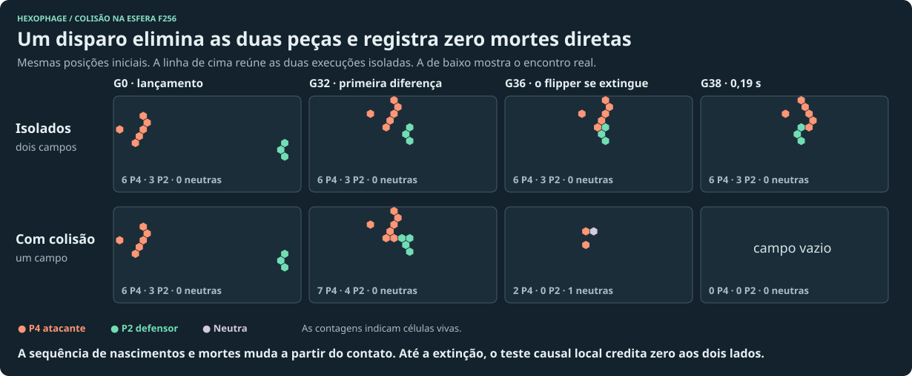

# Quem matou o glider?

Em 1.548 disparos legais, **808 linhagens do glider atacante desapareceram até G96 enquanto o mesmo glider, lançado no mesmo ponto sem adversário, continuava vivo**. Em 784 dessas 808 não houve sequer uma célula do atacante cuja sobrevivência naquele passo teria sido restaurada pela retirada dos vizinhos adversários. Destruir uma nave é um efeito sobre uma linhagem. Uma regra de transferência por morte local enxerga uma fração desses efeitos.

## Ensaio pareado

Usamos o motor da partida, esfera f48, dívidas desativadas, dois jogadores financiados e bots ociosos. O atacante carimbou um P4 de seis células diante de cinco alvos. Para cada alvo testamos seis direções, 13 corredores e quatro momentos de lançamento. Doze dos 1.560 disparos propostos violaram a regra de separação do carimbo e foram descartados. A grade de posições é deliberada e as frequências não estimam probabilidades em partidas reais.

Para cada geração até G96 comparamos o conjunto de células do defensor com uma execução sem ataque. Também comparamos o atacante com um P4 isolado na mesma posição, orientação e idade na mesma esfera. Uma diferença de ocupação conta mesmo se o número de células não mudar. Todo padrão foi carimbado uma vez. A atribuição local considera os donos na geração anterior, mantém os vizinhos neutros e só credita uma morte se retirar os vizinhos rivais teria deixado a célula viva. Nos duelos há só um dono rival elegível.

| Alvo | Disparos legais | Campo do defensor divergiu do controle | Entre divergentes, nenhum crédito por morte do defensor | Defensor perdeu sua linhagem apesar de sobreviver no controle | Dessas eliminações, sem crédito por morte do defensor |
| --- | ---: | ---: | ---: | ---: | ---: |
| Flipper P2 | 312 | 72 | 72 | 60 | 60 |
| Refletor P42 | 312 | 123 | 109 | 39 | 32 |
| Crescedor | 312 | 130 | 115 | 0 | 0 |
| Gun P20 | 300 | 211 | 197 | 0 | 0 |
| Glider P4 | 312 | 37 | 33 | 33 | 29 |
| **Total** | **1.548** | **573** | **526** | **132** | **121** |

Nos 96 passos houve 1.713.991 mortes naturais de células dos dois jogadores. Dessas, 938 ocorreram ao lado de uma célula rival e 80 passaram no teste causal local. Foram 54 mortes do defensor e 26 do atacante. As 80 vítimas haviam nascido naturalmente. Nenhuma continuava viva desde a carimbada que introduziu a estrutura. Em 518 dos 573 ataques que alteraram o campo do defensor, nenhum dos dois jogadores teria recebido crédito. Entre os 286 casos que alteraram apenas a forma do atacante em algum momento, o campo do defensor seguiu sua trajetória de controle. As 52 partidas com mais células do defensor em G96 do que no controle ilustram que uma colisão também pode beneficiar quem recebeu o disparo.

## Replays isolados na esfera f256

| Cena até G256 | Vítimas diretas do atacante / defensor | Células finais do defensor | Sem projétil |
| --- | ---: | ---: | ---: |
| Glider intercepta a ponta do crescedor | 1 / 0 | 36 | 228 |
| Mesma rota, disparo atrasado 16 gerações | 0 / 1 | 47 | 228 |
| Mesmo crescedor, projétil fora da rota | 0 / 0 | 228 | 228 |
| Glider atinge refletor P42 e induz crescimento | 0 / 0 | 186 | 22 |
| Glider elimina flipper P2 | 0 / 0 | 0 | 3 |
| Glider contra glider | 1 / 1 | 0 | 6 |



O P4 sozinho continuava com seis células após 256 gerações. Já tinham morrido **1.280** células suas, todas substituídas por nascimentos. Um carimbo de P20 isolado chegou a 12.839 mortes naturais no mesmo horizonte sem dar nenhum crédito de combate. Repetir o impacto exato do crescedor com o atacante e o defensor pertencentes ao mesmo jogador manteve as 36 células finais e zerou os créditos por contato hostil. Proteger ou sacrificar ativos e ganhar um crédito local são resultados diferentes.

**O valor do disparo existe na economia de maturação.** Em G512, o disparo que acerta contabiliza apenas 100 nascimentos de sua linhagem, e o que passa ao lado, 2.560. Isso economiza 2.460 de energia para a mesma semente de 60. Com prêmio 129 para células nascidas naturalmente que chegam à idade 64, o crescedor atingido acumulou 5 maturações e 2.413 nascimentos, saldo operacional −1.768. Fora da rota houve 339 maturações e 3.051 nascimentos, saldo +40.680. A perda de 42.448 do adversário aconteceu sem crédito por morte de célula do defensor. [Dados das duas carteiras físicas](../pacing/inversion/physics-results.json).

## Quando duas guns acertam só os projéteis

Carimbamos uma P20 para cada lado e nenhuma peça posterior. As duas bocas estavam em direções opostas. A busca variou 11 desvios laterais, três separações e seis atrasos do segundo carimbo em f64. Em 27 dos 198 casos, o campo ocupado, incluindo os donos, entrou em órbita com mortes diretas por contato em cada período. Em 25 o crédito aparecia para os dois lados. Confirmamos dois casos também em f256 até G512, incluindo a recorrência exata das posições e dos donos. Uma economia com caixa suficiente pode sustentar indefinidamente essa mesma dinâmica física.

- **Corredor simétrico.** As configurações inteiras em G36 e G56 são idênticas. Em 20 gerações cada lado perde duas células diretamente por causa do rival. O pagamento de uma energia nova por morte credita 20 energias/segundo para cada jogador a 200 gerações/s. Uma transferência simultânea simétrica dá saldo zero para cada um. Os nascimentos por período foram 560 e 580; as sobrevivências foram 769 e 775, respectivamente. Sob maturação isolada de projéteis de vida curta, o gasto militar por período precisa ser financiado.
- **Corredor assimétrico.** As configurações em G37 e G97 são idênticas. A segunda P20 perde duas células diretamente por período de 60, a primeira, nenhuma. À tarifa de uma energia, o corredor move 6,67 energias/segundo de uma carteira para a outra enquanto durar. Isso pode ser dissuasão ou transferência voluntária entre aliados, dependendo dos interesses reais dos dois jogadores.

| Arquivo | Conteúdo |
| --- | --- |
| [contacts.json.gz](contacts.json.gz) | Trajetórias por geração das cenas nomeadas, grade de 1.548 disparos, controles e quantidades de vítimas originalmente carimbadas |
| [gun-crossfire.json](gun-crossfire.json) | 198 pares de P20 pesquisados, duas órbitas confirmadas em f256 e seus livros por geração |
| [causality.mjs](causality.mjs) | Critério de causa física direta |

```sh
node experiments/combat-economy/contacts.mjs all
node experiments/combat-economy/gun-crossfire.mjs
node --test experiments/combat-economy/contacts.test.mjs
```
