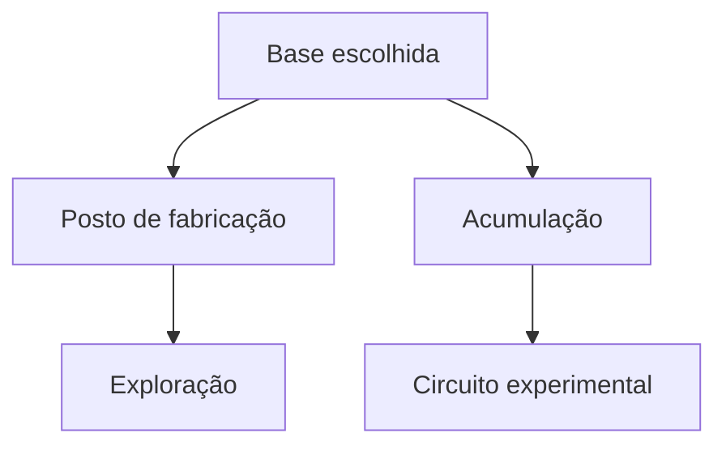

# Fronteira: recursos e contratos de fabricação

Este experimento acrescenta quatro materiais finitos ao modo de economia celular e iluminação. O jogador prepara um plano antes da partida, escolhe sua base e estabelece quais linhagens podem fabricar quais carimbos. A física continua sendo o autômato multirregra do Hexophage.

## Jogar e preparar

Abra `index.html?experiment=resources`. A esfera padrão é F128, com um humano e cinco bots, a 12 gerações por segundo. O jogo começa pausado e com a base em campo. A configuração oferece três modos: economia compartilhada, economia celular com luz, e recursos com plano de construção.

Em **Configurar partida → Seu plano de construção**, selecione uma etapa, escolha **Construído por**, altere iluminação/alcance/capacidade e distribua os 100 pontos de custo. **Adicionar carimbo selecionado como dependente** usa o desenho escolhido no Atlas, incluindo desenhos personalizados. **Usar a forma selecionada nesta etapa** substitui uma receita existente. O JSON permite preparar planos com ferramentas externas e trazê-los para a partida. **Nova partida com estes ajustes** valida a árvore, os pontos e a produção inicial antes de substituir a partida.

O painel mostra os quatro estoques, a origem necessária ao carimbo selecionado e o objetivo de preservar a linhagem-base. As manchas coloridas pertencem ao terreno; células vivas são desenhadas sobre elas. Os depósitos escurecem com a extração e só aparecem sob iluminação atual.

## Regra central

Cada receita recebe um identificador escolhido pelo jogador. Células carimbadas recebem esse contrato; nascimentos naturais herdam o contrato de sua linhagem. O motor acompanha células, energia, parentesco e alcance. A forma pode oscilar, se mover, crescer, construir circuitos e produzir descendentes.

Uma fabricação exige simultaneamente:

1. A quantidade de células e a física declaradas na receita.
2. Uma fonte viva do contrato pai perto de toda a área do novo carimbo.
3. Iluminação atual sobre cada célula proposta.
4. Energia local suficiente para a taxa e a carga inicial das células.
5. Os quatro materiais cobrados pela receita.

A fonte local precisa de pelo menos `ceil(tamanho_da_receita_pai / 4)` células do contrato pai, com mínimo de uma. Um único círculo de fabricação dessa fonte deve cobrir a pegada inteira. O próprio contrato base autoriza construir novas cópias de si. Outros contratos dependem do pai definido pelo jogador.

A condição de derrota é a extinção da linhagem escolhida como base. Cópias da base, descendentes naturais e versões móveis preservam essa capacidade. Destruir uma fonte intermediária encerra sua fabricação naquela região; cópias restantes continuam atuando nos próprios alcances.

## Quatro materiais

| Material | Função implementada | Piso por fabricação |
| --- | --- | --- |
| Substrato · S | Corpo do carimbo | `n` |
| Condutor · C | Raio de visão e alcance de fabricação | `ceil(n × (visão + alcance) / 16)` |
| Acumulador · A | Capacidade de energia de cada célula | `ceil(n × capacidade / 128)` |
| Catalisador · K | Contrato e profundidade da cadeia de fabricação | `ceil(n × (profundidade + 1) / 4)` |

`n` é a quantidade de células da receita. Além dos pisos, cada fabricação paga um orçamento adicional fixo de `2n` unidades. O jogador reparte esse orçamento entre os materiais mediante quatro pesos inteiros que somam 100. O arredondamento usa maiores restos, mantendo a soma exata.

Visão e capacidade entram nos atributos físicos do contrato: `visionRadius` e `cellCapacity`. A carga inicial transferida a cada nova célula é `min(32, capacidade)`. O alcance de fabricação determina o círculo da fonte pai usado na autorização local.

Os materiais ficam no inventário agregado do jogador. Energia e permissão de fabricação dependem das células próximas ao local escolhido. Esse arranjo permite medir o efeito da progressão e dos depósitos junto da economia celular já implementada.

## Orçamento do plano

Cada receita usa pontos de engenharia calculados por:

```text
ceil(log2(n + 1))
+ ceil(visão / 4)
+ ceil(alcance / 6)
+ ceil(capacidade / 128)
```

O plano tem **64 pontos**. Cada linhagem autoriza até **20 pontos de receitas filhas**. O plano inicial usa **43/64**; a base concede **17/20**. Uma cadeia pode ter até 12 etapas e todos os caminhos levam à base.

Essa capacidade local de autorização dá função às fontes intermediárias. O jogador distribui os contratos entre células com distintas posições e vulnerabilidades. O plano inicial é:



Os nomes e formas são exemplos editáveis. Uma mesma regra pode sustentar diversas receitas com capacidades distintas. Carimbos desenhados pelo jogador usam `offsets` e passam pela mesma validação.

## Depósitos e coleta

Os depósitos formam uma camada do terreno, com tipo e quantidade em cada sítio. A semente da partida determina manchas geodésicas compactas. Cada abertura recebe acesso próximo aos quatro materiais.

Uma célula começa a coletar depois de 12 gerações com identidade e vizinhança estáveis. Ela pode retirar material do próprio sítio e dos seis vizinhos. O orçamento de extração é **0,2 unidade por célula e geração**; cada depósito oferece no máximo **0,4 unidade por geração**, repartida entre as coletoras elegíveis. O estoque do depósito diminui exatamente pela quantidade creditada. Fabricar, morrer, borrar e renascer têm contabilidade independente da coleta.

As prévias dos bots clonam inventário, terreno e histórico de coleta. A versão observada do mundo inclui apenas os depósitos visíveis ao jogador simulado.

## Neutralidade dos contratos

O identificador de construção é um atributo herdado, separado da identidade física canônica. Sensores, proteção, detonações e votação agrupam células pela física. Um teste compara **360 combinações** de nove regras, quatro interações, cinco políticas de existência e dois sensores por 12 gerações. Dividir os mesmos desenhos entre vários identificadores mantém geometria, idades, nascimentos, detonações e eleitorado. Isso também evita multiplicar votos apenas cadastrando mais receitas.

Traits econômicos distintos continuam causando diferenças de capacidade, iluminação e financiamento. A autorização acompanha a descendência e sua existência local durante a partida.

## Simulação reproduzível

```sh
node --test experiments/typed-world/game/progression.test.mjs
node experiments/frontier-resources/survey.mjs > experiments/frontier-resources/survey.json
```

O [levantamento](survey.json) contém 15 execuções no motor do jogo: esfera F24, sementes 1/17/73, cinco aberturas e 768 gerações. Cada abertura recebe 640 de energia e zero materiais no inventário. O estoque dos depósitos é finito e há quatro reservas próximas de abertura. A tabela mostra médias das três sementes.

| Abertura | Células finais | Nascimentos naturais | Energia gerada | Materiais coletados |
| --- | ---: | ---: | ---: | ---: |
| Produtora de 4 células → 12 | 12 | 12 | 2.476 | 128 |
| Oscilador Bays de 2 células | 0 | 509 | 0 | 0 |
| Glider Callahan de 6 células | 0 | 443 | 0 | 0 |
| Semente Ashley de 3 células | 0 | 12 | 0 | 0 |
| Nuvem personalizada de 20 células | 0 | 412,33 | 1,33 | 0 |

O erro máximo de conservação dos materiais foi **8,2 × 10⁻¹⁴**, devido à aritmética de ponto flutuante. A produtora esgotou os quatro depósitos próximos. As amostras com atividade contínua consumiram sua energia inicial e terminaram sem células. A nuvem teve produção transitória em uma das três execuções, registrada no resultado agregado.

[A pesquisa dos bots](BOTS.md) inclui três partidas de 256 gerações e um ensaio de 1.024 gerações. O ensaio longo levou o planejador a experimentar os dois contratos de segundo nível, preservando custos reais, informação parcial e o limite computacional por geração.

Os testes cobrem ciclos e raízes inválidas, ponto de engenharia, pisos dos materiais, alcance da fonte, atomicidade de cobranças recusadas, extinção da base, estoque finito e isolamento das previsões. O caso de plano em estrela verifica que concentrar todas as receitas na base excede sua capacidade de contratos.

## Autonomia dos 409 carimbos nas nove regras

O [levantamento completo do catálogo](catalog-survey.json) aplica o motor
celular a cada um dos **409 carimbos reais do Atlas**, com uma condição inicial
uniforme de colocação: **40 de capital bruto por célula**, sendo 8 de taxa
material e 32 de carga transportada. O suporte externo é zero. Cada amostra
usa F32, semente 1, rotação 0, o mesmo centro da esfera e horizonte de 64
gerações. A taxa de produção é 1 para todas as nove famílias.

```sh
node experiments/frontier-resources/catalog-survey.mjs > experiments/frontier-resources/catalog-survey.json
```

Esse ensaio mede a autonomia isolada de um carimbo colocado. Na abertura normal
da partida, a base escolhida recebe os **640 de capital bruto** distribuídos
por suas células iniciais. Os dois cenários estão identificados nos metadados.

O levantamento concluiu **400 simulações**, com nove projeções indisponíveis
na posição e rotação fixadas da esfera. Todas as nove regras têm amostras
simuladas. Nenhuma execução atingiu o limite de 5.000 células ou de 180 segundos.

| Regra | Catálogo | Simuladas | Vivas em G64 | Geraram energia | Vivas e geraram energia | Produtoras qualificadas em G64 |
| --- | ---: | ---: | ---: | ---: | ---: | ---: |
| Callahan | 205 | 205 | 93 | 125 | 67 | 19 |
| Bays | 30 | 30 | 2 | 0 | 0 | 0 |
| Hex B2/S34 | 43 | 41 | 16 | 10 | 9 | 2 |
| Hex B2/S245 | 24 | 23 | 6 | 7 | 5 | 4 |
| Bays 245 | 19 | 19 | 1 | 0 | 0 | 0 |
| Andreen | 32 | 31 | 0 | 0 | 0 | 0 |
| HighHex | 35 | 32 | 10 | 0 | 0 | 0 |
| Ashley15 | 8 | 8 | 0 | 0 | 0 | 0 |
| Ashley | 13 | 11 | 0 | 0 | 0 | 0 |
| **Total** | **409** | **400** | **128** | **142** | **81** | **25** |

Cada registro inclui nome, regra, quantidade inicial, validade da projeção,
estado de conclusão, geração de extinção, renda, energia final, nascimentos e
seu custo, perdas, pico e quantidade final de células, maturidade local e
território explorado. O relatório também fornece médias por família e a
equação de conservação de energia para cada execução.

Esses números distinguem três propriedades úteis para montar o plano:
persistência da matéria, produção acumulada e produção local qualificada ao
fim do período. O saldo de um circuito móvel pode financiar exploração durante
parte do horizonte; os contratos do plano podem colocar esse circuito depois
da criação de fontes de combustível e fabricação. As tarifas e os atributos
por tipo continuam configuráveis no experimento.

## Integração

O módulo [progression.mjs](../typed-world/game/progression.mjs) expõe:

| API | Uso |
| --- | --- |
| `defaultProgressionPlan(initialCard, availableCards)` | Documento inicial editável |
| `normalizeProgressionPlan(plan)` | Valida DAG, custos, atributos e orçamento |
| `progressionSpatialTypes(plan)` | Converte atributos de receitas em tipos do motor |
| `attachProgression(match, options)` | Instala fabricação, coleta e forks consistentes |
| `progression.bootstrap(owner, id, ids)` | Concessão única de abertura |
| `progression.getQuote(owner, id, ids)` | Recurso faltante, fonte, alcance e custo de energia |
| `progression.legalCards(owner)` | Receitas com pai vivo e inventário suficiente |
| `progression.objective(owner)` | Células restantes da linhagem base e derrota |

A chamada de fabricação do motor recebe o contrato como sétimo argumento: `match.stamp(owner, rule, resolver, ids, ballot, sense, {contract: id})`.

## Conexão nova

**Segurança baseada em capacidades.** Cada linhagem carrega uma autoridade de fabricação delegável. A existência física e o alcance local dessa autoridade determinam onde uma ação pode ocorrer. No jogo, destruir uma fonte remove capacidade de ação, enquanto circuitos celulares móveis podem transportar autoridade. Uma nave que produz outras naves torna-se uma fonte de fabricação em movimento desenhada pelo próprio jogador.

## Ressalvas e contrapontos

O levantamento mede amostras isoladas e conservação; os números de taxas, custos, orçamento e alcance são parâmetros experimentais para partidas humanas. A sustentabilidade de circuitos grandes depende de fornecimento local de energia, desenho do autômato e efeitos de colisão. O motor aceita qualquer configuração que satisfaça as mesmas regras locais; uma infestação que se transforma em células estáveis passa a ter a economia dessas células estáveis. A logística física dos quatro materiais permanece uma extensão separada deste teste.

O catálogo completo identifica perfis iniciais e fragilidades sob uma carga
finita comum, não comprova sustentabilidade de todas as máquinas. Renda positiva
pode ser transitória; até um padrão vivo com células maduras pode ter perdido
sua dinâmica original. As nove projeções indisponíveis não são resultados de
extinção, e seus nomes permanecem explícitos no JSON. Uma única semente, rotação
e duração não estabelece equilíbrio entre as famílias nem impossibilidade de
construções que recebam combustível ou sejam preparadas de outra forma.
