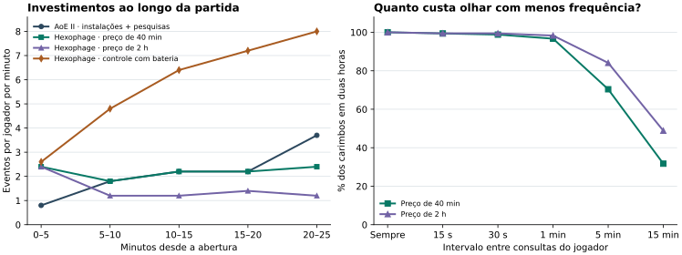

# O ritmo de uma partida de Hexophage

**Minha escolha de design é um RTS de planejamento com combates autônomos.** Uma sessão principal de 25–40 minutos deixa espaço para estabelecer produção, observar o rival e agir sobre sua infraestrutura. Duas horas continuam sendo um bom teste de resistência. O simulador mede o tempo necessário para financiar uma ação e o custo de adiar uma compra. A duração até a vitória depende também do mapa, dos adversários e das condições de eliminação.

O [experimento de inversão](inversion/README.md) estuda uma alternativa que muda o próprio objetivo da disputa. O jogador pode plantar um crescedor para financiar a ofensiva, e um adversário pode neutralizar o crescimento atingindo a ponta com um glider. O teste reproduz essa intervenção no motor físico. Na esfera f320 vazia, todas as 32 colmeias testadas pararam de formar células maduras, ao passo que os 32 gliders isolados permaneceram em voo. Isso muda o custo de lançar uma gun sem linha de tiro. Com essa duração real, o melhor dos 225 ensaios de carteira chegou a 43 min 10 s antes do primeiro déficit; pelos mesmos preços uma estratégia de ataque conseguiu disparar 313 gliders em pouco mais de 13 min.

## Que ação vale contar?

Em 100 replays de elite de Age of Empires II em Arabia, a mediana foi de 1,72 instalações ou pesquisas por jogador por minuto real equivalente. A média foi de 1,91 e a metade central ficou entre 1,40 e 2,38. Incluindo casas e fazendas, a mediana subiu para 2,90. Em StarCraft II, 3.395 registros deram média de 117,05 comandos/min, mas 5,48 trabalhadores e 0,32 unidades complexas produzidas por minuto. Para um carimbo que continua produzindo projéteis sozinho, investimentos e construções oferecem o comparador mais próximo. A contagem de comandos mede outra carga de atenção. Nenhuma dessas amostras estabelece um APM máximo saudável.

Em 1.597.096 duelos ranqueados de uma temporada de AoE IV, a mediana foi 23 min 57 s, o P90 foi 41 min 40 s e 0,0373% chegaram a duas horas. Legion TD 2 tem um paralelo de mecânica. As unidades combatem por conta própria e o jogador decide se investe regularmente para aumentar a renda ou guarda para um ataque concentrado. Ikariam sustenta outra expectativa de presença. A academia de nível 8 leva 1 h 31 min, e as construções continuam na ausência do jogador. [Dados, recortes e fontes](benchmarks.md) · [Manual de Legion TD 2](https://beta.legiontd2.com/manual/).



## Quando a produção ainda vem dos nascimentos

A busca examinou **589.824 combinações de preços × cinco políticas de investimento ou poupança**, totalizando **2.949.120 trajetórias econômicas**. Cada trajetória tinha horizonte de duas horas a 200 gerações/s. A triagem reavaliava a compra a cada cinco segundos e comportava várias compras no mesmo instante. A resolução aumentou para um segundo e depois uma geração nas finalistas. Uma implementação independente confirmou 11 parametrizações. Em seguida, 107 estratégias, inclusive carimbos compostos, foram aplicadas a quatro candidatas em 428 ensaios adicionais. A busca ampla pertence à economia em que nascimentos dão renda. A inversão tem ensaios e denominadores próprios.

As comparações abaixo usam a mesma carteira, que alterna dois gliders, um flipper P2 e um P4 depois da fundação. As naves têm vida econômica de um minuto. A rajada mede quantos flippers podem ser pagos no mesmo instante depois de jogar 110 minutos e guardar por dez.

| Preço do carimbo | Carimbos em 40 min | Em 2 h | Intervalo mediano entre compras | Rajada economizada |
| --- | ---: | ---: | ---: | ---: |
| Pressão por massa, meia-vida de 2 min 45 s | 92 | 331 | 22,3 s | 30 |
| Pressão por massa, meia-vida de 5 min | 57 | 176 | 44,8 s | 20 |
| Pressão quadrática, meia-vida de 80 min | 71 | 153 | 52,7 s | 18 |

A primeira curva se aproximou mais do ritmo de investimento observado no AoE II até o minuto 25. A segunda preservou mais território livre sob reinvestimento agressivo. Com 40 flippers após a fundação e depois apenas guns, um jogador chegou a 23,1%, 8,8% e 83,6% da área do f320 nessas três curvas aos 120 minutos. A hipótese de sobrevida dos projéteis é decisiva. Na segunda curva, se as emissões durarem dez minutos, a mesma projeção ultrapassa a área inteira aos 119,74 minutos. Regiões reais podem colidir muito antes. [Teste das estratégias](policy-stress.md).

Na primeira curva a célula custa inicialmente 1.500, o primeiro flipper custa 4.500 e cada nove células pagas dobram o preço marginal. A segunda usa 350, 1.050 e seis células. A reserva de abertura sempre compra um P2. A memória do que foi plantado cai com a meia-vida indicada. O custo de uma nova peça é a soma dos preços marginais das suas células. Reunir dez flippers em um desenho custa o mesmo que pagar dez no mesmo instante. Uma regra que cobrava por clique pareceu melhor na triagem e falhou nesse teste do editor. Uma gun custa 52 células. Quem pode pagar essa gun também pode pagar dezessete flippers de três células no mesmo instante. A frequência com que o jogador consegue repetir a rajada informa mais que seu tamanho isolado.

Mudar a abertura também muda a estratégia. Com quatro P2 antes da primeira gun, as duas curvas exponenciais levaram 20,53 e 23,00 min. Ao comparar 45 aberturas por regra, nas duas venceu a sequência de um P2 e sete P4. O tempo caiu para 10,15 e 13,54 min. O resultado inclui capital de giro para a gun. Uma partida real pode exigir gastar na defesa durante essa poupança.

## Que presença a economia pede?

| Quando a carteira mista podia emitir ordens | Curva de 2 min 45 s, carimbos em 2 h | Curva de 5 min, carimbos em 2 h |
| --- | ---: | ---: |
| A cada geração | 331 | 176 |
| A cada 30 s | 327 | 175 |
| A cada minuto | 320 | 173 |
| A cada 5 min | 233 | 148 |
| A cada 15 min | 105 | 86 |

Na primeira curva, observar a cada 30 s preservou 98,8% das compras. Depois de 30 min investindo e oito horas fora, o jogador tinha financiado 67 peças e podia pagar até 42 flippers ou duas guns ao voltar. Quem continuou consultando a cada 30 s financiou 1.805 no mesmo relógio. Na curva lenta, foram 43 peças e 32 flippers extras disponíveis ao voltar, contra 866 peças financiadas pelo jogador presente. Essas consultas são políticas de jogador. A economia permite gastar o saldo inteiro no mesmo instante.

O relógio militar é muito mais rápido. A 200 gerações/s, o glider P4 avança 100 arestas/s. A separação mediana de 480 arestas entre os pontos iniciais do f320 corresponde a 4,8 s de viagem em um caminho livre desse comprimento. Em uma colisão observada, um flipper preposicionado preservou um refletor P42 por 256 gerações. Plantar o mesmo flipper fora da rota custou o refletor. Em outro teste, trocar apenas a trajetória de um P4 interrompeu permanentemente o crescimento de uma colmeia isolada. São decisões de posição com consequências persistentes. [Ensaios de combate](tempo.md) · [Inversão e ataque ao crescedor](inversion/README.md).

## Arquivos para reproduzir os resultados

- [Fontes e extração dos benchmarks](benchmarks.md), [protocolo, equações e busca numérica](sweep-protocol.md), [controle das estratégias e dos pacotes](policy-stress.md).
- [Resultado das finalistas](results-finalists.csv), [limiares e contagens de cada refinamento](results-search.json), [controles antigos](legacy-results.json), [atenção, perda de ativos e aberturas](holdouts.json).
- [Simulação da inversão e observação do autômato](inversion/README.md). O código do jogo fica na versão de dev que serviu de base ao estudo. Os cenários de pesquisa são executados separadamente.

Para reproduzir os controles e os dados de atenção a partir da raiz:

```sh
node experiments/pacing/legacy.mjs experiments/pacing/legacy-results.json
node experiments/pacing/attention.mjs --rule '{"id":"mass-short","price":1500,"massPressureDoubling":3,"pressureHalfLife":33000}' /tmp/pacing-short.json
node experiments/pacing/attention.mjs --rule '{"id":"mass-long","price":350,"massPressureDoubling":2,"pressureHalfLife":60000}' /tmp/pacing-long.json
node experiments/pacing/attention.mjs --rule '{"id":"poly-long","price":2500,"massPressureScale":14,"massPressurePower":2,"pressureHalfLife":960000}' /tmp/pacing-poly-long.json
node experiments/pacing/openings.mjs /tmp/pacing-openings.json
python3 experiments/pacing/holdouts.py /tmp experiments/pacing/holdouts.json
python3 experiments/pacing/figures.py
```
