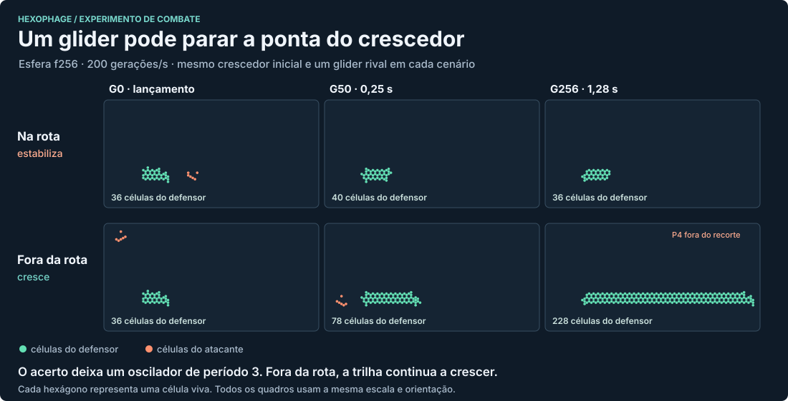

# Colmeias sob ataque

**O crescedor funciona como objetivo militar.** Um glider barato atingiu sua ponta e converteu o campo inteiro em um oscilador de período três. Decidir quem produz energia muda o incentivo para lançar esse ataque. O resultado também depende de pagar pela célula que sobrevive a cada geração ou pelo evento único de ela ter se estabelecido.

## Inverter as duas operações atuais

No jogo, uma célula viva que sobrevive na mesma posição pelo segundo instante tem idade 2. A primeira inversão testada dá uma energia a cada uma dessas sobreviventes e cobra uma por nascimento natural. Nascer, morrer e ser carimbada são três operações distintas. O preço padrão de carimbar continuou em dez por célula no controle linear.

| Padrão | Resultado com +1 por sobrevivente e −1 por nascimento |
| --- | --- |
| Flipper P2 | Perde 1 por geração. A compra consome as 30 energias da abertura atual e já falta energia na primeira geração. |
| Glider P4 | Perde em média 3,5 por geração de voo. |
| Gun P20 | Ganha 788 acumuladas até G80. Com a frota viva, já perdeu 1.403 até G256 e 14.302 até G512. Uma P20 comprada sem capital de giro começa a sofrer erosão em G193. |
| Crescedor | A semente de 36 células custa 360. Financia outra pelo preço linear em 12 gerações, ou 0,06 s. Sua renda por geração cresce cerca de 0,75 a cada geração de idade. |
| Oscilador P2 de seis células (C6-1) | Ganha 3 por geração em média, com semente de 60. É uma das alternativas comerciais à colmeia. |

O balanço da P20 ajuda a entender o fogo à queima-roupa. No primeiro período seu mecanismo dá **+15,10 por geração em média** sob a inversão simples. Cada P4 que permanece em voo custa **3,5**. Num modelo em que os projéteis desaparecem sem deixar descendentes, quatro gliders mantêm o conjunto em +1,10 por geração. Cinco o levam a −2,40. Na esfera real os destroços podem mudar de dono e continuar evoluindo. Se a intenção for fazer da gun uma despesa em qualquer alcance, remunerar continuamente a base fixa é uma escolha importante.

O censo dos 160 padrões encontrou 137 com fluxo constante positivo ou média periódica positiva, incluindo 130 osciladores e duas naves. Cinco emissores têm ganhos que diminuem à medida que a frota cresce. Só o crescedor tem fluxo positivo com inclinação crescente. Cobrar também a morte reduz a quantidade de osciladores que lucram de 130 para 18. A diferença importa para distinguir a duração da ocupação de uma posição do movimento de uma nave. [Perfis, abertura, variantes e definição de instabilidade](catalog.md).

Se o nascimento custar seis, o crescedor passa a ser o único dos 160 com fluxo crescente ou positivo no longo prazo em espaço livre. Um jogador pode, porém, desenhar padrões fora do atlas. Um carimbo legal de 36 células num editor de 15×15 custa os mesmos 360 da colmeia e ganha 6 por geração em média, sem giro inicial. As posições se repetiram exatamente em G1, G4 e G7. Esse tronco com pontas fechadas financia uma cópia em 0,30 s. A versão de 56 células ganha 24 por geração com a mesma tarifa. Aumentar o tronco aumenta o rendimento com o mesmo número de nascimentos. [Construção e verificação na esfera](catalog-custom.mjs).

## O que sobrevive a uma busca de duas horas

Foram **65.536 configurações × duas fundações × cinco políticas = 655.360 trajetórias econômicas**. Variamos o preço inicial, o peso do nascimento e quatro formas de precificar ou manter o campo. O relógio teve 1.440.000 gerações a 200/s. Comparamos uma fundação C6 com uma colmeia concedida, ambas sem caixa, para tirar a falta de dinheiro inicial do caminho. A abertura padrão de 30 foi examinada separadamente. O simulador verifica solvência, área do f320, defesa inicial, acesso à P20 e cadência entre uma e seis compras/min na carteira mista. A marca de dez mil ordens apenas indica quando o investimento já se trivializou para esta análise.

No subconjunto de 21.844 configurações com recompensa e custo exatamente iguais a um, 1.931 mantiveram as carteiras econômicas examinadas além de 40 min partindo de colmeia. Entre essas configurações, o máximo de compras mistas dos minutos 30 a 40 foi 0,3/min, e a primeira P20 mais cedo foi aos 30,08 min. Nenhuma passou pelos critérios conjuntos nas duas horas. O controle linear financiou dez mil colmeias em 109 gerações no modelo de reinvestimento imediato e espaço livre. Esse número mede capacidade de compra. Mesmo sem fundar uma segunda colmeia, prolongar a inclinação do primeiro tronco por duas horas já ultrapassaria a área total do mundo. Colisões e o destino da ponta são decisivos. [Busca, fronteira e 210 reavaliações por geração](search.md).

## Pagar uma vez pela estabilidade

A variante dá um prêmio quando uma célula nascida naturalmente alcança **64 gerações consecutivas na mesma posição**. Cada nascimento custa uma energia. Uma célula carimbada diretamente não recebe o prêmio. Escolhemos 64 para ensaiar a diferença entre um núcleo que continua parado e um rastro que se estabelece continuamente. A 200/s, isso corresponde a 0,32 s de sobrevivência. A carteira do jogador guarda livremente a energia recebida.

No catálogo completo, apenas o crescedor continuou produzindo novas células maduras nas janelas tardias observadas. A ponta estabelece **0,75 célula por geração** e produz em média **143 nascimentos em 24 gerações**. Com prêmio 12, a renda líquida por frente em movimento é 73/24, aproximadamente **+3,04 por geração**, independentemente do comprimento do tronco. Um padrão de período três pode receber por um local que se estabelece durante a abertura. Depois, qualquer posição ou está sempre viva ou morre antes de completar 64 gerações novamente. Por isso o tronco fechado também perde sua renda recorrente. Para qualquer prêmio, outra estrutura com um ciclo longo ou um rastro que amadureça merece o mesmo tratamento pelas regras.

| Motor real, esfera f256, últimas 128 das 512 gerações | Inversão simples, energia/G | Prêmio único de 12, energia/G |
| --- | ---: | ---: |
| Crescedor intacto, ou P4 inimigo fora da rota | +362,16 | +3,04 |
| Mesmo crescedor, mesmo P4 inimigo direcionado à ponta | +29,34 | −4,66 |



No ataque bem-sucedido, todos os donos e posições voltaram exatamente ao mesmo estado entre as gerações 47 e 50, com economia financiada. Na G512 restavam 40 células do dono, contra 421 sem o ataque. Cortar a ponta tirou 86,5% da renda acumulada no regime simples. Sob prêmio único, a renda futura virou despesa. Separadamente, 1.220 janelas de validação até G4.000 confirmaram nascimentos e maturações das linhagens isoladas. [Confronto, dados por geração e verificação externa](physics.md).

## Quanto custa sustentar o ataque?

A maturação exige financiamento inicial. A primeira colmeia custa 360 no preço linear e precisa de **376 adicionais** para passar a juventude sem erosão, quando só as células nascidas naturalmente podem receber. Portanto, esse ensaio daria a cada jogador uma colmeia e 376 de giro, ou 736 para fundá-la. Com prêmio 12 e a tarifa inicial lenta da pesquisa de preços, uma colmeia isolada leva **4 min 23 s** para devolver seu próprio preço mais baixo de 159.700. Com preço linear de 360, devolve o investimento em **1,48 s**. O preço seguinte depende da massa plantada recentemente.

A conta militar mostra por que o prêmio ainda precisa de uma relação com o mapa. Um glider P4 isolado custa 5 por geração de voo nesse regime. Uma P20 lança uma nave a cada 20 gerações. Se cada nave circular durante cinco segundos, a fábrica com sua frota custa 270,95 por geração em média. Com prêmio 12 isso requer **90 frentes** de colmeia contínuas para uma gun em regime permanente. Com prêmio 384 basta **uma**. Se os projéteis durarem um minuto, seriam respectivamente **994 ou 11 frentes**. Esses são requisitos de sustentação. É possível usar uma reserva para financiar um ataque por tempo limitado ou lançar um glider manual.

Uma maneira de escolher o prêmio é partir do exército que se deseja sustentar. Escolhemos como hipótese de design três frentes para uma P20 com voo de cinco segundos. Como a gun consome 270,95 por geração, a recompensa mínima inteira é **129 por célula que amadurece**. Cada frente líquida fornece cerca de 90,79 por geração. Para voos de um minuto passam a ser necessárias 34 frentes. Sob o prêmio de 129, só a colmeia recuperou sequer o preço inicial ao fim de algum dos blocos observados nos 160 perfis, quando células carimbadas não recebem. Isso não abrange todos os desenhos que o editor aceita. Na tarifa lenta, a primeira colmeia sem concorrência leva 9,12 s para devolver seu preço inicial. A fila de ampliações e o financiamento da gun demoram mais.

Também testamos **96 carteiras a cada geração**, combinando três tarifas, quatro prêmios, duas vidas de projétil, duas prioridades militares e dois comportamentos de reserva. Usamos a sequência observada de nascimentos e maturações de cada semente, sem pagar pelas células carimbadas, e permitimos várias compras por instante. A opção de conservar giro mantém caixa para as frentes novas e oscilações de fase. Com prêmio 12 e a tarifa lenta, cinco colmeias em expansão livre já projetam mais que o f320 em 36,1 minutos sem financiar uma P20 sustentável. Com prêmio 384, vida de cinco segundos e a mesma tarifa, a política prudente financiou sua primeira P20 aos 18,6 s e chegou a quatro guns e quatro frentes antes do limite de área aos 45,1 min. Com prêmio 129, cinco segundos de voo e a mesma tarifa lenta, a política prudente financiou a primeira P20 aos **8 min 26 s**. A soma projetada dos campos de seis frentes livres superou o f320 aos 33,56 min. Com um minuto de voo, a mesma política nem chegou a financiar uma P20 com renda permanente antes de cruzar a área do mundo. A aproximação conta apenas a área projetada dos crescedores. Nenhum dos dois resultados mede um preenchimento real, que depende de bloqueios e rotas no mapa. [96 carteiras](frontier-results.json) · [Financiamento da primeira colmeia](maturity-payback.json) · [Custo militar em cinco tempos de voo](front-runway.json).

## O que o terreno faz com o crescedor

Repetimos o ensaio na esfera real f320 de 1.024.002 células, em oito pontos (três pontos iniciais e cinco coordenadas de semente reproduzível), quatro orientações por ponto. Cada peça foi financiada para medir sua trajetória intrínseca isoladamente. O algoritmo esparso usa a vizinhança do próprio jogo. Uma trajetória de crescedor e uma de P4 foram conferidas com o motor completo, incluindo ocupação, nascimentos e maturações. Os 32 ensaios compartilham a mesma esfera.

- As 32 colmeias acabaram em órbitas fechadas, 31 de período 3 e uma de período 15. O último amadurecimento natural ocorreu aos **38,40 s em 30 colocações**, aos 8,68 s em outra e aos 3,06 s na última. Na inversão contínua inicial, o mesmo terreno produz o efeito contrário. Nos 30 remanescentes típicos houve 5.738 células na fase registrada, período três e apenas 14 nascimentos por período. Em qualquer fase há pelo menos 5.724 células e o fluxo médio S−B é a população média menos duas vezes o número médio de nascimentos. Portanto, essas fazendas já paradas renderiam pelo menos **5.714 por geração** indefinidamente se permanecessem intactas. No prêmio único, a renda já acumulada permanece livre para gasto. O resíduo, porém, continuou gerando despesas entre 4,33 e 4,73 por geração.
- Com prêmio 12 ou 32, **zero das 32** recuperou o preço inicial de 159.700 para outra colmeia na tarifa lenta. Com prêmio **129, 30 das 32 recuperaram** em 9,12 s. A maior renda operacional acumulada foi **691.101**, abaixo do menor preço dessa mesma tarifa para uma P20 (1.027.594). Duas aberturas, porém, nem conseguiram recompor o capital da semente com a própria produção. Local e orientação são escolhas econômicas, e um ponto inicial ruim pode prender o jogador.
- Com prêmio 129, 376 iniciais de giro e nenhuma ordem adicional, o caixa do dono atingiu o primeiro déficit aos **55 s**, **3 min 04 s** ou **aproximadamente 12 min 59 s** (30 colocações). A partir daí o jogo pode corroer células. As condições de eliminação não fazem parte dessa projeção.
- Os **32 gliders P4** isolados voltaram ao mesmo estado após **3.200 gerações**, equivalentes a 16 s. Isso é um circuito de voo, não uma expectativa de vida. Uma nave continua gerando despesa até interagir. O teste de cinco segundos na conta das guns representa um combate com alvo, e o de um minuto representa uma rota mais livre.

As extrapolações anteriores de frentes livres mostram como as tarifas se comportariam se o espaço permitisse crescimento indefinido. Aqui o próprio terreno invalidou essa premissa dentro do primeiro minuto. Somar várias trajetórias isoladas também deixa de valer quando elas se encontram. [Calibração física e dados de cada posição](sphere-fronts.json) · [Código do ensaio](sphere-fronts.mjs).

### Duas horas com a vida das colmeias medida na esfera

Substituímos as frentes infinitas pela colheita e pelo custo residual observados nas três classes de abertura do f320. Usamos as sequências iniciais medidas, uma aproximação do fluxo durante a fase produtiva e a despesa do ciclo final. Cada nova colmeia tem seu próprio relógio. No primeiro lote foram 162 carteiras consultadas a cada segundo, mais 27 reavaliações a cada décimo de segundo. Cada consulta pode financiar várias compras. Nenhuma das 189 concluiu duas horas sem um primeiro déficit. O melhor resultado de 12 min 59 s foi a colmeia típica guardando toda a renda. A abertura de maior produção e a tarifa lenta permitiram repor uma colmeia e lançar dois P4 de passagem de cinco segundos; o déficit veio aos 7 min 39 s. Com a tarifa reduzida para 100 por célula da abertura, uma gun pôde ser lançada aos 17 s, mas o caixa se esgotou aos 20,44 s. Uma segunda bateria acrescentou 36 carteiras com memória de preço de 3, 10 ou 20 s e uma política que adia a reposição até a última oportunidade financiável. **Nenhuma das 225 carteiras chegou às duas horas sem déficit.** A melhor chegou a **43 min 10 s** com 18 novas colmeias, usando p=100 e meia-vida de 3 s. Sob os mesmos preços, a carteira ofensiva lançou **313 gliders em 13 min 02 s**, cerca de 24 por minuto, antes de entrar em déficit. Nenhuma das 225 pagou uma segunda P20. São carteiras e cenários concretos. Outras estratégias de lançamento e reconstrução, o atrito entre colônias e a erosão posterior ao primeiro déficit podem mudar a partida. [Carteiras sob colheita finita](finite-portfolio.md).

O mecanismo que vale preservar é a disputa pela ponta. Para qualificar um preço para a partida real, a informação decisiva é **a distribuição da duração das frentes produtivas e dos voos até a colisão**, incluindo partidas com um adversário que tenta cortar o crescimento. A mesma P20 pode consumir a renda de três ou de 34 frentes no prêmio 129, conforme a duração dos voos. O estudo distingue isso da velocidade de clicar. Não encontrou um ajuste pronto para promoção.

## Reprodução

A partir da raiz do repositório, o catálogo, a comparação física e a validação usam as regras e a geometria já fornecidas pelo jogo. A busca C++ tem [instruções próprias](search.md).

```sh
node experiments/pacing/inversion/catalog.mjs
node --test experiments/pacing/inversion/catalog-custom.test.mjs
node experiments/pacing/inversion/physics.mjs
node experiments/pacing/inversion/physics-holdout.mjs
node experiments/pacing/inversion/sphere-fronts.mjs
node experiments/pacing/inversion/maturation.mjs experiments/pacing/inversion/maturation.json
node experiments/pacing/inversion/front-runway.mjs
node experiments/pacing/inversion/maturity-payback.mjs
node experiments/pacing/inversion/frontier.mjs
```
