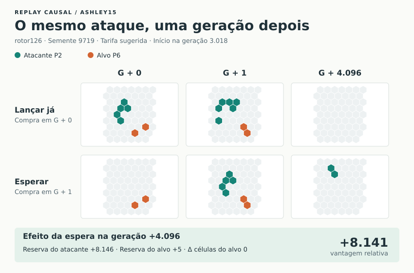

# Lugar e fase do ataque em Ashley15

Cinco bots sem memória jogaram 32.768 gerações por partida na esfera F40
(16.002 sítios), com conflito de linhagem e crescimento clássico. A primeira
série usou as três sementes de desenvolvimento que revelaram um erro na
comparação de fases. As duas séries seguintes usaram outras três sementes após
fixar o critério. A tarifa `activity` é o perfil de atividade original. A tarifa
`suggested` é a sugestão de abertura de Ashley15 no jogo. Repetimos as três sementes da
validação com a cobrança por campo vazio habilitada após a carência de 512
gerações. Os resumos das partidas e as 68 linhas de resultados dos pares
permaneceram idênticos.

| Tarifa | Sementes | Ataques comprados | Compras que escolheram a fase posterior | Melhores / iguais / piores em 4.096 gerações | Mediana da diferença de reserva relativa |
| --- | --- | ---: | ---: | ---: | ---: |
| Atividade original, desenvolvimento | 4751, 8329, 1049 | 70 | 9 | 8 / 0 / 1 | +8.160,00 |
| Atividade original, validação | 19271, 7069, 9719 | 83 | 16 | 15 / 0 / 1 | +6.138,75 |
| Sugerida, validação | 19271, 7069, 9719 | 121 | 17 | 17 / 0 / 0 | +8.141,00 |

Cada par compara o mesmo carimbo, alvo, centro e orientação. A partir do mundo
na geração da proposta, duas cópias da esfera evoluem sob as regras do jogo.
Na primeira, o bot paga e lança imediatamente. Na segunda, só paga e lança
quando chega a fase posterior considerada pelo bot. As duas evoluem até o mesmo
instante sem mais compras. A medida é a diferença entre as reservas próprias e
do adversário escolhido, no ramo posterior menos no imediato. Medimos a 64,
512, 4.096 e 16.384 gerações. As contagens de sinal da tabela foram iguais nas
quatro janelas. Com a tarifa sugerida, a variação a 4.096 foi de +5 a +14.321.

Também repetimos o jogo com todas as ordens reais para conferir a sequência e o
saldo final. Em cada uma das 42 compras de fase posterior, verificamos a
recorrência do disco local orientado de ocupação e maturidade e da vizinhança
do alvo imediatamente antes de aplicar a ordem. Em 41 pares, as fases foram observadas
com um intervalo de uma geração. No outro par, o intervalo foi de duas gerações.
As ordens reais saíram entre 95 e 937 gerações após a proposta, quando o cérebro concluiu a comparação, havia
saldo, a fase reapareceu e o intervalo de compra permitiu a jogada. Nenhum par
destas partidas precisou ser excluído por intervenção no intervalo entre as
fases ou por mudança de local na hora da compra.

O bot consulta até oito sítios para propor expansão e até três sítios por rival
para propor ataques, usando os índices de células vivas e de nascimentos.
Compara até três poses de campo por rodada e pode avaliar uma segunda fase da
mesma pose quando o alvo muda em até oito gerações. A espera só entra na disputa
se os dois ensaios cobrem o mesmo horizonte, permanecem financiados e não
atingem a borda. A vantagem de caixa relativa precisa superar o fluxo positivo
que se perde ao aguardar, sem piorar o fluxo relativo no fim do ensaio.
Os cérebros compartilham um orçamento de 768 visitas por geração, com crédito
inicial de 8.192. O registro inclui reservas de trabalho para a prospecção,
cópias locais, simulações, observações e a conferência das posições antes da
compra. Os replays de esfera inteira são instrumentos do experimento.

A amostragem aproxima os melhores locais encontrados. Os resultados de fase
medem o efeito daquela decisão em Ashley15 e sob a política declarada de
suspender compras posteriores. Para reproduzir uma partida, execute o comando
na raiz do repositório. A saída padrão traz as linhas por ataque e horizonte.
O resumo da partida segue na saída de diagnóstico.

```sh
node experiments/tactical-learning/phase-sites.mjs 19271 40 32768 ashley15 suggested
```

Os arquivos `phase-games.csv` e `phase-replays.csv` guardam os nove jogos e
todos os pares, respectivamente.

## O ataque mediano sob a tarifa sugerida



Escolhemos o nono dos 17 lançamentos, ordenados pela diferença de reserva
relativa a 4.096 gerações. No replay da semente 9719, P2 lança o mesmo
`rotor126` junto a P6 na geração 3.018 ou 3.019. Na última coluna, a região
do lançamento imediato ficou vazia. No lançamento posterior, duas células do
atacante ocupam essa região. No planeta inteiro, esperar aumenta a reserva
de P2 em 8.146 e a de P6 em 5, com a mesma população final de P6 em ambos os
ramos. Nesta jogada a vantagem adicional veio da produção do atacante.

A figura pode ser recriada diretamente a partir das células e dos saldos
dos dois ramos, com o comando abaixo.

```sh
node experiments/tactical-learning/phase-sites.mjs 9719 40 32768 ashley15 suggested 3018 experiments/tactical-learning/phase-median.svg
```
