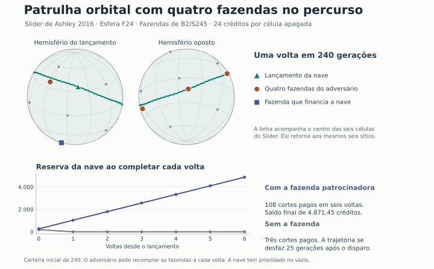

# Colisões entre carimbos de físicas diferentes

Uma fazenda B2/S245 de guarda e um oscilador Bays de fase começaram em regiões distantes da mesma esfera, sob um único dono com 160 créditos. Durante **1.024 gerações**, a posição de cada célula de cada formação coincidiu com sua trajetória no motor original de uma só regra. A fazenda estabilizou em 12 células, sustentou a alternância do oscilador e o dono terminou com **8.167,45** créditos. Com carteiras separadas, o oscilador também começou com 160, deixou de reproduzir a forma nativa em G73 e desapareceu. A fazenda conservou os seus 12 sítios e acumulou 10.231,45. [Controle de portfólio](duels-portfolio.csv)

## Quem vence a colisão?

O ensaio principal cruzou quatro pares de carimbos e os quatro resolutores em 72 pistas. Em cada pista, as 16 atribuições ordenadas de resolutores usaram a mesma reserva de 768 por lado, o mesmo alvo, o mesmo estado de maturação e a mesma pose de lançamento. **As 1.152 execuções chegaram à adjacência direta.** O ramo de espera deixa o defensor evoluir sem tiro. Os valores abaixo são as medianas em G+96 para os nove impactos de validação de cada par, com nave em fase e alvo material. O voo usa a arbitragem por apoio em nascimentos simultâneos no vazio. Sobrescrever um sítio ocupado custa 24 além do nascimento.

| Nave e alvo | Primeira adjacência | Campo do alvo, tiro / espera | Efeito no caixa do alvo | Vantagem financeira do atacante sobre esperar | Ataques que compensaram |
|---|---:|---:|---:|---:|---:|
| Glider Bays × crescedor Callahan | G+1 a +15 | 108 / 116 | −223,87 | −313,66 | 3/9 |
| Slider Ashley 2016 × fazenda B2/S245 | G+7 a +9 | 0 / 12 | −1.112,26 | +780,26 | 9/9 |
| Nave Andreen × oscilador Bays | G+12 a +15 | 0 / 2 | +163 | −661 | 0/9 |
| Glider Bays × Slider Ashley 2016 | G+3 a +4 | 0 / 6 | +455 | −1.223 | 0/9 |

A vantagem inclui o custo de comprar e manter a nave. Na economia de estabilidade, destruir uma formação que vinha gastando dinheiro pode **aumentar** a reserva futura do defensor. Já um corte de poucos sítios pode desmontar toda uma fazenda e interromper sua renda. O livro cobra a troca de um sítio inimigo ocupado; as mortes naturais seguintes são medidas por comparação com o ramo de espera. [Duelos individuais](duels-league.csv) · [Sensibilidade a caixa e preço](duels-prices.csv)

## Condorcet depende do que o mapa recompensa

Construímos 36 pistas em F32 para exploração e 36 em F48 para validação. Mudaram a orientação, o desvio lateral, a semente de desempate e a idade de lançamento (para o encontro entre duas naves, mantivemos a idade). As pistas são variações estruturadas, não partidas independentes amostradas de uma população. Para o voto da pista, cada resolutor ataca uma vez e defende uma vez contra o mesmo adversário. Comparamos a diferença média de reserva nas duas pernas e, separadamente, a diferença média de população. Empates de até 0,01 crédito contam como empates.

| Duelo em F48, G+96 | Por reserva, esquerda / empate / direita | Por células vivas, esquerda / empate / direita |
|---|---:|---:|
| Contato × fase | 18 / 4 / 14 | 8 / 7 / 21 |
| Contato × guarda | 0 / 36 / 0 | 0 / 36 / 0 |
| Contato × antimatéria | 36 / 0 / 0 | 14 / 16 / 6 |
| Fase × guarda | 3 / 16 / 17 | 10 / 20 / 6 |
| Fase × antimatéria | 35 / 0 / 1 | 16 / 13 / 7 |
| Guarda × antimatéria | 36 / 0 / 0 | 14 / 21 / 1 |

A fase ganha do restante **por campo**, contando as preferências estritas em cada confronto. A G+384 isso persistiu, com 17–1 contra contato, 5–1 contra guarda e 9–0 contra antimatéria. Há muitos empates. Exigindo 19 votos favoráveis dos 36 em cada confronto, nenhum dos quatro satisfaz esse critério territorial. Por reserva, contato e guarda empatam entre si e ambos superam os demais em G+96. A guarda tem a mesma física de contato no confronto direto e sua proteção contra fase não é acionada. Esses ordinais medem campo e saldo no horizonte, não a conquista da partida. [Matrizes por pista, família e amostra](duels-matrix.csv)

O [segundo protocolo](duels-design.md) variou sete preços por apagamento e quatro adicionais na compra de guarda, em 6.048 confrontos de seleção. Nenhuma das 28 combinações produziu um ciclo financeiro estrito entre contato, fase e guarda no agregado. O melhor ponto pelo critério predefinido empatou uma das arestas na seleção e na confirmação. Na comparação de sensibilidade, com guarda custando 1 a mais por célula comprada, o vencedor por reserva muda. A 4 por apagamento, fase vence contato 17–15, guarda 22–14 e antimatéria 34–2. A 24 por apagamento, contato vence fase 18–14, guarda 32–2 e antimatéria 36–0. A confirmação reutiliza os mesmos encontros para isolar o efeito dos preços. [Grade](duels-tariffs.csv) · [Confirmação](duels-tariffs-validation.csv) · [Prazos e preços](duels-sensitivity.csv)

## A nave que atravessa

Comparamos cada fotograma da nave com uma cópia da esfera em que ela voa sozinha. Em **72 pistas F48** por condição (quatro pares de carimbos, seis ângulos, três desvios), a variante de prioridade permite à fase vencer uma disputa simultânea no vazio. A guarda residente apoiada mantém seu veto e a carteira ainda precisa financiar os cortes.

| Caixa inicial da nave | Alvo | Prioridade da fase | Trajetória inteira intacta e viva até G+96 | Pistas com cortes pagos | Trajetória intacta por dois períodos a partir do primeiro corte |
|---:|---|---|---:|---:|---:|
| 16.384 | Contato | Desligada | 31/72 | 59 | 24/59 |
| 16.384 | Contato | Ligada | 72/72 | 63 | 63/63 |
| 16.384 | Guarda | Desligada | 23/72 | 30 | 16/30 |
| 16.384 | Guarda | Ligada | 30/72 | 34 | 21/34 |
| 240 | Contato | Ligada | 0/72 | 56 | 8/56 |

Contra o crescedor Callahan, em 18/18 pistas o glider Bays bem financiado com prioridade percorreu os mesmos sítios que em voo solo, contabilizando 605 substituições inimigas. Desligar a prioridade permitiu à formação material vencer nascimentos no vazio e desviou ou quebrou o glider nas 18 pistas. A taxa de apagamento registrou apenas cortes executados. [576 trajetórias pareadas](duels-passage.csv)

## O custo de uma patrulha orbital



Na esfera F24, o Slider Ashley 2016 volta aos seis sítios de lançamento a cada **240 gerações**, depois de chegar a 164° da origem. Quatro fazendas B2/S245 de contato foram plantadas sobre essa rota. A cada volta, o defensor tenta recomprá-las pelo preço normal nas mesmas posições. Uma fazenda distante do atacante, quando habilitada, compartilha a carteira da nave. Em todas as condições, a fase tem prioridade no vazio.

| Reserva | Preço por corte | Fazenda patrocinadora | Voltas intactas de 6 | Cortes pagos | Caixa final do atacante |
|---:|---:|---|---:|---:|---:|
| 240 | 24 | Ausente | 0 | 3 | 0 |
| 240 | 24 | Presente | 6 | 108 | 4.871,45 |
| 240 | 96 | Presente | 0 | 6 | 13.763,45 |
| 3.840 | 96 | Presente | 6 | 108 | 695,45 |
| 24.000 | 96 | Ausente | 6 | 108 | 6.384 |

A tarifa de 24 financiou a travessia recorrente com folga quando a fazenda sobreviveu. Cada volta estabilizada rendeu **2.400 créditos** e gastou **1.200 em nascimentos e 18 vezes o preço do corte**. O ponto de equilíbrio observado foi **66,67 por corte** neste corredor. A 96, a reserva de 3.840 absorveu seis voltas deficitárias. Quando o jogador tinha só 240, a nave desfez-se na primeira volta e a fazenda continuou acumulando caixa sozinha. Alvos mais espaçados reduzem a frequência de cobrança. Uma defesa estacionária com muitas células vitais adjacentes pode perder mais valor do que o total de cortes pagos. [24 patrulhas](duels-orbit.csv) · [Corredor adicional com cinco fazendas](duels-corridor.csv)

## Reprodução

No diretório do repositório, use Node 22 ou superior e Python 3. O laboratório e os ensaios usam o mesmo motor. A geometria, os seis rumos e o relógio de reconstrução da patrulha são compartilhados com a prévia jogável.

```sh
cd experiments/typed-world
python3 duels.py 4
python3 duels-tariffs.py 4
python3 duels-sensitivity.py 4
node duels-passage.mjs > duels-passage.csv
node duels-orbit.mjs > duels-orbit.csv
node duels-corridor.mjs > duels-corridor.csv
node duels-portfolio.mjs > duels-portfolio.csv
python3 duels-orbit-figure.py  # matplotlib, numpy
```

[Coexistência no mesmo dono nas pistas de colisão](duels-friendly.csv) · [Motor do laboratório](engine.mjs)
