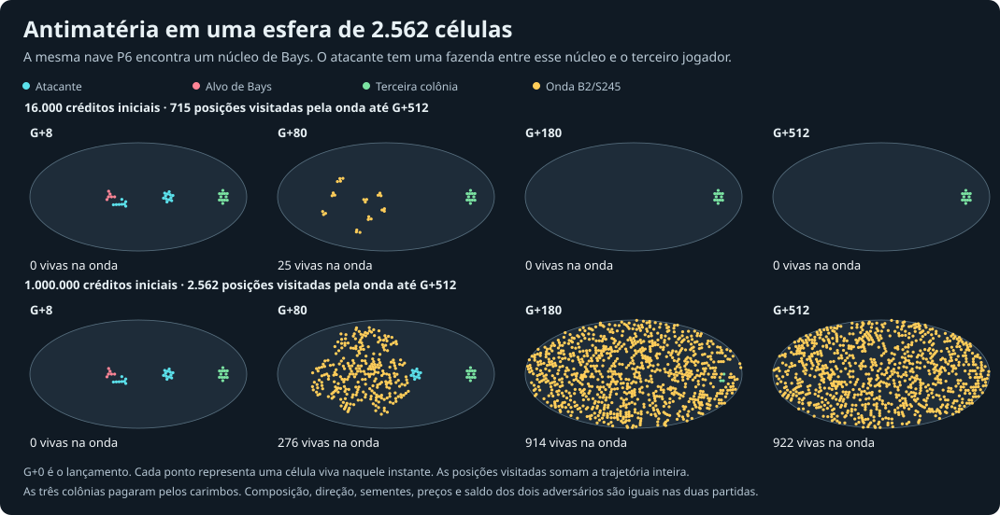

# Uma nave de antimatéria pode engolir o planeta?

Em uma esfera de 2.562 células, um atacante com um milhão de créditos conseguiu fazer a onda passar por **todos os 2.562 sítios**. A própria fazenda desapareceu antes da última colônia inimiga. Quando deixamos a física e o caixa continuarem, a onda esgotou o dinheiro do patrocinador e se extinguiu em G+609. Com 16 mil créditos, no mesmo lançamento, a onda visitou 715 sítios e a terceira colônia sobreviveu intacta.



## O gatilho e a física da onda

O portador segue a regra do seu carimbo até encostar em um tipo diferente. O teste principal usa uma nave P6 de nove células de B2/S245 e um oscilador P2 de seis células de Bays, com três células sempre vivas. O alvo e a fazenda patrocinadora crescem durante 16 gerações antes do lançamento. O grupo conectado que faz contato é consumido e tenta semear um triângulo de três células, com um vértice no alvo. Essas reivindicações disputam os sítios e são cobradas da carteira. A linhagem resultante usa a tabela **B2/S245** da malha real, inclusive nos pentágonos. O formato e a velocidade da frente emergem a partir daí.

Conferimos o triângulo em isolamento no motor físico original. Ele teve 54, 108, 291 e 471 vivas em G+16, +32, +48 e +64, tanto no plano quanto na esfera F32. Um par adjacente teve duas em cada medição. A montagem da carga é uma regra nova. A expansão depois da ignição reaproveita a física que gerava o surto antigo. [Controle físico independente](blast-native.jsonl)

No bug original, a nave P6 colidia com a fazenda 4→12 sob uma única física. Repetimos esse caso clássico sem economia em F32. Com a fazenda presente, o campo passou de 41 vivas em G+16 para 287 em G+64 e 3.768 em G+512. Sozinha, a nave ficou em 11 em G+64, mas também chegou a 3.509 em G+512 naquela trajetória esférica. Por isso medimos a linhagem da onda separadamente das células do portador.

## Quanto crescimento a carteira sustenta

Em F32 (10.242 sítios), o mesmo atacante pagou uma fazenda remota 4→12 e a nave. Cada nascimento normal custou 1 crédito, cada nascimento de onda custou 4 e cada célula ocupada apagada pela onda custou mais 24. Cada sobrevivente convencional liquidado rendeu 8. A renda dos sítios maduros começa na idade 12 e satura sobre toda a carteira. A posição, o alvo, a fase e a orientação são os mesmos nas cinco linhas. G+0 é o lançamento. O contato ocorre em G+10.

| Caixa inicial | Pico de onda viva | Sítios distintos atingidos | Maior distância do primeiro impacto, em arestas | Primeira liquidação | Última onda desaparece |
|---:|---:|---:|---:|---:|---:|
| 280 | 30 | 57 | 6 | G+17 | G+28 |
| 800 | 57 | 101 | 7 | G+25 | G+30 |
| 3.200 | 123 | 249 | 10 | G+41 | G+54 |
| 16.000 | 423 | 931 | 23 | G+66 | G+84 |
| 64.000 | 807 | 2.132 | 33 | G+104 | G+124 |

Na esfera F320, de 1.024.002 sítios, o mesmo ensaio com 280, 3.200 e 64.000 créditos atingiu respectivamente 50, 248 e 2.164 sítios distintos. Na série principal de 45 cenários F32 (cinco saldos, três bases, três direções), o alvo perdeu todo o campo nos 45, mas manteve reserva para reentrar. O atacante faliu nos 45. Esse tiro destrói uma fonte de renda barata ao preço de expor toda a economia de quem disparou.

A passagem fria de seis transportadores (P6 ou nave de Andreen, três orientações de cada) não detonou até G+384. Os seis impactos contra Bays detonaram. Uma segunda série, com 8.192 créditos, testou as seis orientações de cada transportador. Em uma orientação da P6 a carga ficou oscilando em pares, tocou só quatro sítios e o atacante conservou a fazenda. Nos outros 11 lançamentos a onda visitou entre 401 e 583 sítios e levou os atacantes à falência. A ignição registra uma tentativa de detonar. A frente precisa se sustentar fisicamente e financeiramente depois dela.

## Fazenda resiliente e venda forçada

A estabilidade continua pagando quando uma fazenda e um projétil usam físicas diferentes. Em F32, com 3.200 créditos e a fazenda 18→66, comparamos a mesma ordem em G+768. Ao autorizar a liquidação por 8 créditos por célula, 44 sobreviventes foram vendidos e o restante se desfez. A onda desapareceu em G+67 e o atacante terminou com 0,65 crédito. Ao proteger a fazenda da venda (`salvage=0`), todos os 66 sítios sobreviveram, ainda havia duas células de onda e a reserva chegou a 13.234,07. Muitos nascimentos propostos foram recusados nos dois regimes. Preservar receita durante o choque teve mais valor do que alimentar a onda a qualquer preço nessa posição.

A tarifa por liquidação também pode criar um segundo motor para o surto. Com reserva inicial 280 e fazenda 18→66, aumentar o valor de revenda de 8 para 128 elevou a área visitada de 95 para 8.881 sítios. Como sobreviventes podem nascer e ser vendidos em gerações sucessivas, o total liquidado pode exceder o número de células do carimbo. O incremento de 128 foi usado para expor esse mecanismo. Todos os cenários principais usam 8.

### Recuperação com liquidação ativa

O laboratório permite reservar um número de **produtores maduros da venda forçada** em cada carteira. Entre os sobreviventes convencionais sem disputa, são reservados os mais antigos, com desempate estável pelo sítio físico. A proteção fiscal não altera a tabela do autômato. A falta de vizinhos ainda pode destruir a estrutura e a frente da onda ainda pode arrasá-la. O valor inicial é zero.

Para testar uma base de duas físicas, o patrocinador compra a fazenda 4→12 de B2/S245 e, 16 gerações depois, o oscilador P2 de Bays num segundo local. Espera mais 16 gerações e paga a nave. Na geração do lançamento possui 12 células da primeira fazenda e seis células do P2. Comparamos quatro pisos na mesma posição. Foram três saldos (800, 3.200, 16.000), três rotações (0, 2, 4) e três sementes (1, 43, 211), totalizando 27 casos por piso. O teste de recuperação exige uma liquidação real, um ganho posterior de pelo menos 72 créditos sobre o saldo mínimo desde essa venda e uma compra aprovada no motor. A compra do novo P6 acontece numa cópia exata da posição para manter comparáveis as trajetórias originais até G+384.

| Produtores protegidos | Fizeram venda forçada | Voltaram a comprar após a venda | Faliu o patrocinador |
|---:|---:|---:|---:|
| 0 | 27/27 | 0/27 | 27/27 |
| 11 | 27/27 | 0/27 | 27/27 |
| 12 | 27/27 | 27/27 | 0/27 |
| 18 | 0/27 | — | 0/27 |

Na semente 1, orientação 0, reserva inicial de 3.200 e piso 12, **as três células fixas do P2 jovem foram vendidas em G+63**. As demais morreram em G+64. A carteira chegou a **0,45**. A onda acabou em **G+83**. A fazenda antiga recuperou saldo suficiente para comprar outro P6 em **G+89**, com **78,51** para um custo de 72, e terminou em **3.028,51**. Nas repetições com o piso 12, em 16 dos 27 casos houve uma compra possível depois de toda a onda se extinguir. Nas outras 11 o atacante já voltou a ter uma compra possível com a onda ainda presente no horizonte observado. O valor 12 preserva justamente este núcleo físico de 12 células. Protegendo 11, a perda de um membro permitiu que a regra desmontasse a estrutura.

No controle da frente planetária de um milhão, reservar até 100 células maduras da venda ainda deixou a própria fazenda sem nenhum sítio convencional até G+200. As células foram atingidas fisicamente. [108 comparações de recuperação](blast-floor.csv) · [Teste de regressão](blast-floor.test.mjs)

## Quem ganhou quando a onda passou por tudo?

Na figura, os outros dois jogadores começaram com 10.000 créditos cada. A ordem de desaparecimento das últimas colônias convencionais com um milhão foi alvo de Bays em G+14, patrocinador em G+161 e terceira fazenda em G+183. Contar a última colônia convencional declara a terceira facção vencedora em G+161. Contar a própria onda como território declara o patrocinador em G+183. Continuar a simulação até a insolvência deixa ambas as carteiras adversárias capazes de comprar uma célula após a onda acabar. São condições de encerramento diferentes aplicadas ao mesmo registro.

O pico foi de 998 células de onda vivas de uma só vez. No acumulado a frente passou por toda a esfera e cobrou do atacante 10 substituições inimigas e 62 aliadas. A população dos dois donos também pode morrer pelas próprias regras após perder seus vizinhos. O tributo conta as substituições efetivamente executadas. No controle de 16 mil, a onda desapareceu em G+87, a fazenda distante conservou as 12 células e o patrocinador ficou com 1,47 crédito.

## Reprodução

O ensaio contém 130 condições dirigidas, incluindo controles repetidos e duas janelas da mesma trajetória. Os jogadores pagam cada compra e não colocam reforços depois do disparo. Os dados incluem o saldo, gasto por nascimentos e apagamentos, venda de ativos, falência, área única, raio e população final. A cada execução o runner confere a conservação contábil do patrocinador. O valor `0` nas colunas de primeira ocorrência significa evento ausente dentro do horizonte.

```sh
python3 experiments/typed-world/blast-survey.py 4
node experiments/typed-world/blast-native.mjs
node experiments/typed-world/blast-floor.mjs
node --test experiments/typed-world/blast-floor.test.mjs
node experiments/typed-world/blast.mjs 16 1000000 small armed 0 1024 contact 8 1
node experiments/typed-world/blast-figure.mjs
```

[130 simulações com carteiras](blast.csv) · [Núcleo e colisão clássicos](blast-native.mjs) · [Construção da figura](blast-figure.mjs)
